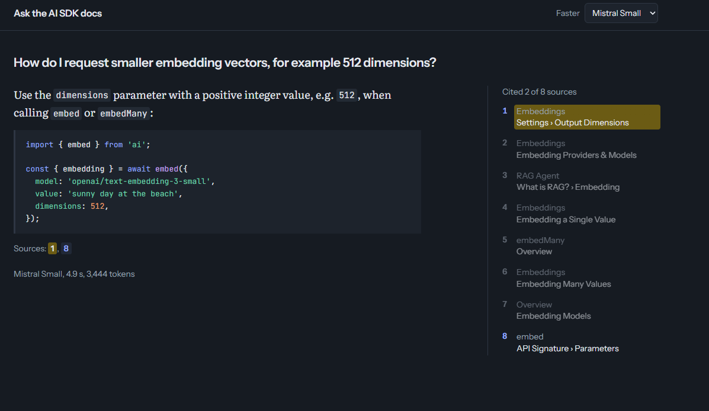
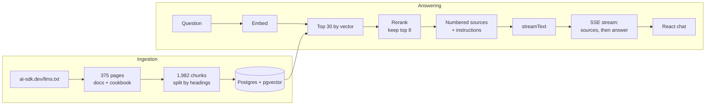

# Ask the AI SDK docs

A question-answering bot over the [Vercel AI SDK 7](https://ai-sdk.dev) documentation. Every answer cites the docs sections it is based on, and an eval suite measures each change, so the bot's accuracy is a number, not an impression.

**Live demo: [ask-ai-docs-agent.onrender.com](https://ask-ai-docs-agent.onrender.com)**. It runs on a free instance that sleeps when idle, so the first visit can take about a minute to wake up.

**Built it, measured it, improved it:** small open models answer 2 of 29 questions correctly on their own. With this pipeline they answer all 29 correctly and stop inventing answers to questions the docs don't cover. On 168 harder questions written afterwards, they answer about 97% correctly.



## Results

35 questions about AI SDK 7: 29 the docs can answer and 6 they can't (the bot should decline those). Answers are graded by an LLM judge from a third model family against reference answers.

| | Retrieval | Qwen 3.8 27B correct | Mistral Small correct | Unanswerable declined | Hallucinated |
|---|---|---|---|---|---|
| Model alone | none | 2 / 29 | 2 / 29 | 3 / 6 | 3 per model |
| RAG v2 | hybrid search, 5 chunks | 24 / 29 | 23 / 29 | 6 / 6 | 0 |
| RAG v3 | vector search, 8 chunks | 27 / 29 (both runs) | 24–28 / 29 | 6 / 6 | 0 |
| RAG v4 | + source type labels | 28 / 29 (both runs) | 28 / 29 (both runs) | 6 / 6 | 0 |
| **RAG v5** | **+ reranking** | **29 / 29** (both runs) | **29 / 29** (both runs) | **6 / 6** | **0** |

- **Outdated answers went from 6–10 per model to zero.** Without the docs, both models write AI SDK 4–6 code: `maxSteps`, `fullStream`, `generateObject`, `system`.
- **Hallucinations went to zero.** Without retrieval the models invented a "128 tools" limit, a "30 seconds" MCP timeout and npm download counts. With it, they say the docs don't cover it.
- **It doesn't cost more.** The sources add ~3k input tokens per question, but the models reason less when the answer is in front of them. A full run of 35 questions costs about $0.05 with Qwen and $0.02 with Mistral.
- **The last miss was a retrieval problem, fixed by reranking.** At 29 / 29 this eval is saturated: it shows the pipeline works, but it can no longer rank improvements. So two harder sets followed.

## Harder evals

Two more question sets, written with Claude from the live docs on November 6 (the bot's snapshot is from November 1), with duplicates of the original set removed. Together with the original set, that makes 203 questions.

| Set | Questions | What it tests | Qwen 3.8 27B | Mistral Small | Unanswerable declined |
|---|---|---|---|---|---|
| Original | 35 (29 + 6) | v7 renames, plain-language questions | 29 / 29 | 29 / 29 | 6 / 6 |
| Hard 1 | 75 (72 + 3) | v6 → v7 version traps, changed defaults, agents and tool approvals, multi-hop, code rewrites, false premises | 70 / 72 | 71 / 72 | 3 / 3 |
| Hard 2 | 93 (88 + 5) | ~25 doc pages: errors and retries, `useChat` transports, streaming data, resumable streams, middleware, providers, testing, agents, telemetry | 84 / 87 | 83 / 87 | 5 / 5 |

RAG v5, one run per set. Hard 1 is graded after fixing three wrong references (see below). Hard 2 leaves out one question whose answer isn't in the November 1 snapshot.

- **With the best configuration, the bot answers about 97% of realistic docs questions, however they're phrased.** The misses are retrieval, not wording. Two facts failed in both sets: in v7, response bodies are excluded by default, and `onStepFinish` was renamed `onStepEnd` (missed in a code rewrite). Hard 2 asks both again as "anchor" questions. Other sections of the same page outrank the chunk that holds the answer.
- **Predicted difficulty didn't predict anything.** Each hard-2 question was labeled easy, medium or hard before the run. Leaving out the two anchors and the snapshot gap, "hard" questions scored 65 / 66, the same as "medium" (97 / 100).
- **A string check and the judge reached opposite conclusions.** On hard 1, checking for required identifiers said Mistral was significantly worse than Qwen (63 vs 69 of 72, exact McNemar p = 0.03). The judge disagreed with 9 of those verdicts and found the models tied (they differ on 1 question, p = 1.0). String checks fail correct paraphrases, and they flag old names that an answer mentions only as deprecated.
- **References were wrong again**, three times in hard 1. One error came from the docs themselves: the loop-control guide says `WorkflowAgent` has no default step limit, while its reference page says `generate()` defaults to 20.
- **Cost:** a 93-question run costs $0.18 with Qwen and $0.08 with Mistral, plus $0.16 to judge both. Judging is about half of all eval spend.

These sets are close to saturated too, so they won't rank small changes. They can still separate configurations that are clearly worse, such as no reranking, fewer chunks, or no retrieval at all. That comparison is the next step, in a separate eval framework.

## Why this is hard

AI SDK 7 renamed or removed much of what models learned from earlier versions:

| Models write | AI SDK 7 uses |
|---|---|
| `system` | `instructions` |
| `stepCountIs(5)`, `maxSteps` | `isStepCount(5)` |
| `result.fullStream` | `result.stream` |
| `onFinish` | `onEnd` |
| `needsApproval` on the tool | `toolApproval` on the call |
| `experimental_context` | `toolsContext` + `contextSchema` |
| CommonJS, Node 18 | ESM only, Node 22+ |

A model's training data is full of the old names, so a correct answer has to come from the current docs, not from memory.

## How it works



- **Ingestion.** `llms.txt` turned out to be the entire docs in one file, so it is split locally into pages and committed as a snapshot (with a SHA-256 per page), which makes every eval reproducible. Pages are chunked at headings, never inside code blocks; long parameter lists and tables are split with their parent line or header repeated.
- **Retrieval.** `text-embedding-3-small` vectors in pgvector with an HNSW index. The top 30 chunks are reranked by Cohere Rerank (via OpenRouter) and the best 8 kept. If the reranker is slow or down, retrieval falls back to the vector order instead of failing. Full-text search and weighted reciprocal rank fusion are implemented too; an experiment chose vector-only (see below).
- **Generation.** The chunks go into the prompt as numbered `<source>` blocks, each labeled with its type (guide, reference, cookbook, ...). The instructions: answer only from the sources, cite them as `[n]`, prefer guides and reference over cookbook examples when they disagree, never recommend code from the migration guides' "Before" blocks, and say "I couldn't find it in the docs" instead of guessing.
- **API.** Fastify, `POST /api/chat`. It speaks the AI SDK's UI message stream protocol, so the frontend uses `useChat` directly. The sources are sent as `source-url` parts before the answer starts. If the client disconnects, the model call is aborted.
- **UI.** React + Vite. Each `[n]` in the answer is a footnote marker linked to its source in the margin; pointing at a marker highlights the source, and sources the answer didn't cite are faded.

The project uses the AI SDK itself as its LLM client, through OpenRouter.

## What I learned

**The first retrieval eval measured the labels, not retrieval.** It scored whether the top results came from the page each question was written from, and reported recall@5 = 0.41. But the answers are spread across many pages (`isStepCount` appears on 8). Retrieval kept finding correct pages that weren't the labeled one. Scoring instead on whether a retrieved chunk actually contains the answer's key identifiers ("evidence") gave 0.94, later corrected to 0.88 when one evidence term turned out to be too loose.

**Hybrid search looked best until the questions changed.** On the first 16 questions, which name exact APIs, hybrid (full-text + vector) won. On 13 new questions in plain language, full-text found almost nothing and pushed good vector results out of the merged list. An experiment scoring six configurations on the same candidates picked vector-only with 8 chunks: 0.91 of the evidence retrieved vs 0.78 for the original hybrid, at the same context size. That one change took Qwen from 24 to 27 correct.

**Similarity isn't relevance.** The last failing question asked how to embed "document chunks for RAG" while limiting parallel requests. Vector search returned seven chunks about RAG; the answer was at rank 12. A reranker, which reads the question and each passage together, put it at rank 1, and lifted the evidence to rank 1 for 28 of 29 questions (evidence in the top 8: 0.91 → 0.97). It costs $0.0002 and about a second per question. Before that, a chunker bug looked like the cause and was fixed, but measuring showed it wasn't the reason.

**Near-miss sources are where hallucination comes back.** When retrieval returns chunks that are related but don't contain the answer, a small model is tempted to fill the gap from memory, even when told not to. Better retrieval fixed that more reliably than prompt wording.

**The docs can contradict themselves.** The v7 guide says to use `toolApproval`; a cookbook page in the same docs still teaches the deprecated `needsApproval`. With both retrieved, the models followed the stale one in 3 of 4 answers. RAG faithfully repeats whatever the corpus says. Labeling each source with its type (from the URL path) and one sentence on which type wins fixed it in 4 of 4, for ~100 extra tokens per question.

**The judge is only as good as its references, and it's noisy on borderline answers.** Re-grading the same baseline answers changed 12 of 70 verdicts (mostly "outdated" vs "wrong"); the clear-cut RAG answers barely moved. Twice a model was marked down for a correct detail the reference didn't list, and both times the reference was fixed, not the model. So "correct" is the headline metric, and runs that matter are repeated.

More detail, including every intermediate number, is in [docs/PROGRESS.md](docs/PROGRESS.md).

## Evaluation

| Script | What it measures |
|---|---|
| `eval:baseline` | Both models answer with no retrieval: the "before". |
| `eval:retrieval` | Retrieval alone: evidence@k (share of required facts found in the top k chunks) and MRR, for vector, full-text and hybrid. |
| `experiment:retrieval` | Scores several retrieval configurations on the same candidates with one embedding request. |
| `eval:rag` | Both models answer with retrieved sources; also checks that every cited `[n]` exists and that a cited source contains the evidence. |
| `eval:judge` | Grades a run against the reference answers: correct / acceptable / outdated / wrong, or declined / hallucinated. |
| `check-coverage` | Every page an eval question cites exists in the docs snapshot. |

`eval:rag` and `eval:judge` take `--questions <file>` to use another question set (the default is `evals/ai-sdk-evals.json`, and the judge uses the set a run recorded).

The judge (`google/gemini-3.6-flash`) is from a different model family than the two models it grades, and is told to ignore its own knowledge of the SDK, which is as outdated as theirs. Runs worth keeping are frozen in `evals/baselines/`.

## Run it locally

Requirements: Node 22+, Docker, an [OpenRouter](https://openrouter.ai) API key.

```bash
cp .env.example .env     # then put your OpenRouter key in .env
npm install
npm run db:up            # Postgres + pgvector in Docker (port 5432)
npm run db:migrate
npm run chunk-docs       # corpus snapshot → data/chunks.jsonl
npm run embed            # ~620k tokens, about $0.01

npm run dev:api          # http://127.0.0.1:3000
cd web && npm install && npm run dev   # http://localhost:5173
```

From the terminal: `npm run ask -- "How do I stop a tool loop after 5 steps?" --model qwen`.

Scripts read `.env` if it exists; variables already set in the environment take precedence, so a secrets manager works too.

To refresh the docs snapshot: `npm run fetch-docs`, then `chunk-docs` and `embed` again (only changed chunks are re-embedded).

## Deployment

- **App:** one Docker service on Render's free tier. The Fastify server serves both the API and the built web app, so there is a single URL and no CORS. The instance sleeps after 15 idle minutes.
- **Database:** Neon (serverless Postgres with pgvector), loaded with the same `db:migrate` and `embed` scripts as the local database. The health check doesn't touch the database, so it doesn't keep Neon awake, and the connection pool survives Neon closing idle connections.
- **Cost control:** a rate limit of 6 questions per minute per visitor, and a separate OpenRouter key with its own small credit limit, which caps what the public demo can ever spend.

## Project structure

```
data/corpus/        Docs snapshot (Markdown) + manifest with a hash per page
evals/              Questions, frozen baseline runs (runs/ is gitignored)
scripts/            Ingestion, embedding, evals, experiments, CLI client
src/retrieval/      Vector, full-text and hybrid search
src/rag/            Prompt, citation parsing, retrieval config, models
src/api/            Fastify server and the /api/chat route
web/                React chat (Vite, Tailwind, useChat)
docs/PROGRESS.md    Full lab notebook: decisions, every run, lessons
```

## Limitations

- **Single-turn.** Each question is answered on its own; follow-ups like "and for streamText?" would need query rewriting first.
- **A snapshot,** taken on November 1, 2026. Provider pages and migration guides older than 5→6 are not included. Docs added after that date are missing; one hard-2 question already falls in that gap.
- **Full-sentence questions only** in the eval. Bare identifiers ("isStepCount") are where full-text search should help, and they aren't tested yet.
- **All three question sets are close to saturated** for the best configuration, so they can't rank changes that differ by a question or two. Each result is a single run graded by a single judge, and the judge flips on about 17% of borderline answers.

---

Unofficial project, not affiliated with Vercel.
